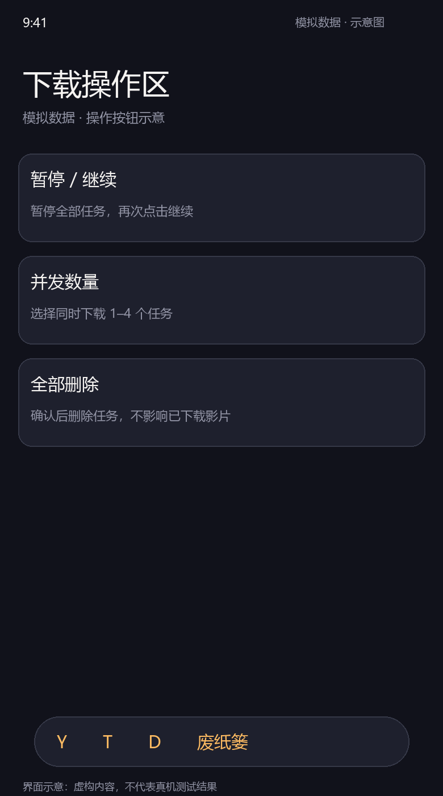
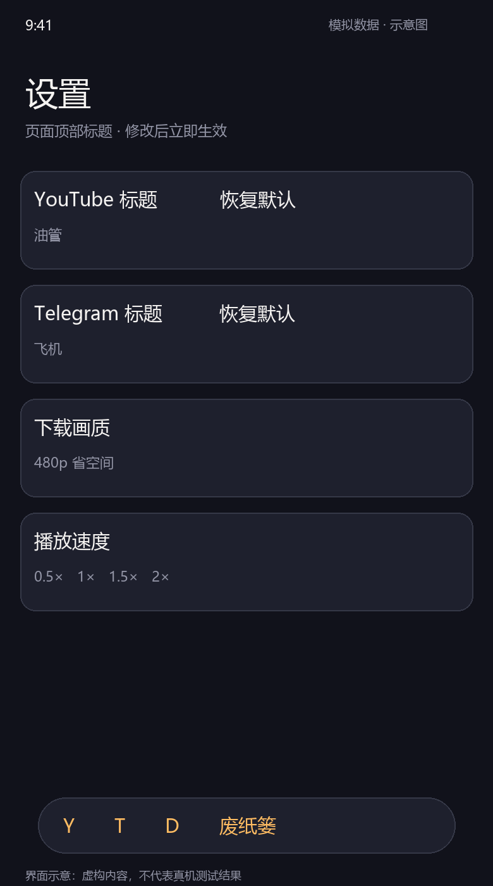

# 拾影使用教程

本教程按实际界面操作顺序说明：导入链接、下载、播放、清理和 Telegram 大视频登录。本文配图均为使用虚构内容绘制的界面示意图，不是真机截图，也不代表测试证据；不同机型布局会略有差异。配图不含用户真实片库或 Telegram 会话。

## 1. 界面总览

底部有四个入口：

| 入口 | 作用 |
| --- | --- |
| **Y**（YouTube） | 已下载的 YouTube 视频，按 YouTube 分组浏览与连播 |
| **T**（Telegram） | 已下载的 Telegram 视频，单独分组；首次进入需设置访问密码 |
| **D**（正在下载） | 下载队列、进度、暂停 / 继续、并发数 |
| **废纸篓** | 播放过或手动删除的视频，保留 7 天 |

四个入口互不干扰：下载中的任务统一在 D 查看，YouTube 与 Telegram 的片库和连播也各自独立。

## 2. 添加视频

### 方式一：分享面板（最顺手）

1. 在 YouTube App、Safari 或 Telegram 中点「分享」。
2. 在分享面板里选择「拾影」。如果没有看到，点「更多」把它打开。
3. 链接会自动解析并进入下载队列，不需要再手动粘贴。

### 方式二：在 App 内粘贴链接

1. 点右上角的 **+**。
2. 粘贴链接，支持：
   - YouTube 单条视频：`https://www.youtube.com/watch?v=...`
   - YouTube 播放列表：`https://www.youtube.com/playlist?list=...`
   - Telegram 公开帖子：`https://t.me/频道名/123`
   - Telegram 公开频道：`https://t.me/频道名`
3. 按需选择「下载画质」，默认是「最高可用（最高 1080p）」。
4. 点「开始下载」。播放列表会一次性加入队列，并自动去重。

### 方式三：剪贴板自动识别

开启「设置 → 剪贴板 → 自动读取剪贴板」后，打开 App 或从后台回到前台时，如果剪贴板里有受支持的链接，会直接导入。iOS 首次会询问是否允许粘贴：

- 选择「允许粘贴」即可自动导入。
- 不想自动读取时，可关闭开关；仍可在添加页点「粘贴剪贴板」手动导入。

> 已导入过的链接会跳过，不会重复下载。

## 3. 下载队列

所有任务都进入 **D** 页面，按加入顺序排队，同时下载数量默认为 2，可在页面顶部切换（1–4 个）。

> 整页截图拍摄于图标按钮改版前。当前下载页顶部的操作区如下：左侧是暂停/播放，中间是并发数菜单，右侧是全部删除。

- **全部暂停 / 全部开始**：点左侧琥珀色胶囊里的暂停图标；暂停后图标切换为播放，标题下方显示「已全部暂停」，再点一次恢复全部任务。
- **并发数**：点中间的「# 2 个」菜单在 1–4 之间切换，只影响之后开始的任务，不会中断正在下载的任务。
- **全部删除**：点右侧珊瑚色描边的垃圾桶图标；确认后会取消正在下载和排队中的任务，已下载完成的视频不受影响。
- **单任务操作**：**左滑**条目可以直接删除任务；长按条目可以重新下载、取消自动重试或删除。
- **下载速度**：下载中的条会显示实时速度和总进度，页面标题下方显示所有任务的总速度。
- **失败重试**：网络波动会先自动重试 5 次；仍失败时点按该条目即可手动重试。
- **画质不可用时自动升级**：例如选了 360p，但该视频只提供 720p，App 只会对这一个视频自动改用更高的可用画质（最高 1080p），并在开始下载时提示；其他视频仍按你选的画质下载。
- **后台继续下载**：YouTube 使用系统后台传输；Telegram 大文件由 TDLib 传输，App 会借助后台音频保持进程存活。切到后台或锁屏后通常仍会继续，极长时间后台可能被 iOS 暂停，回到 App 后会自动接着下载。
- 强退 App 后重新打开，未完成的任务会尽量自动恢复；无法恢复的任务会提示重新导入。

## 4. 播放

- 在 Y / T 片库里点视频进入全屏播放；废纸篓不可播放，需先右滑恢复。
- **最小化 / 迷你播放条**：播放页左上角的向下箭头会把播放器收到标签栏上方，变成一条迷你播放条并继续播放；点标题区域恢复全屏，点右侧 × 停止播放。迷你条边框会随状态呼吸：播放时泛淡绿光，暂停时转成淡红光。
- **横屏**：播放页右上角的旋转按钮可在横屏 / 竖屏之间切换。横屏视频可以横过来看；播放页允许跟随设备方向旋转（系统竖排方向锁定开启时请用旋转按钮）。
- 支持拖拽进度、快退 / 快进 10 秒，以及画中画（系统允许时）。
- **倍速播放**：在「设置 → 播放速度」里选择 0.5× / 1× / 1.5× / 2× / 2.5× / 3× / 3.5× / 4×。选中后所有视频默认按该速度播放。
- **长按临时加速**：播放时长按画面，会在当前速度上再加速 0.5×（例如 1× 变 1.5×），松手立即恢复。
- 连播只在当前分组内进行：YouTube 队列播完不会接着播 Telegram，反之亦然。也可以在分组菜单里选择「仅本组连播」。
- **左滑删除**：在片库里向左滑动条目，滑到大约行宽一半时松手即可删除；长按条目也会出现「移到废纸篓」等操作。
- 视频**开始播放后**会自动进入废纸篓（文件仍在本地），7 天后才真正删除，期间可随时恢复。

## 5. Telegram 视频

Telegram 公开频道和公开帖子都可以直接导入，下载完成后出现在 **T** 分组：

### 访问密码

第一次进入 **T** 时，App 会要求设置一个访问密码（至少 4 位）。密码保护整个 Telegram 模块，包括群组浏览、会话和已下载列表，不只是锁定下载内容。

- 设置并解锁后，App 会记住解锁状态，不会每次启动都反复要求输入；密码摘要只保存在本机钥匙串，建议记牢。
- 输错密码会进入一个只读的**演示对话界面**，其中只有示例技术聊天，不会显示你的真实会话或片库。
- 在演示界面**下拉**可以回到密码输入；也可以点「重新输入」。
- 输错一次后，App 会记住这次错误密码：下一次必须输入正确密码，或者再次输入同一个错误密码，否则只会提示重新输入。
- 退到后台时，App 会清空输入框、搜索词和当前打开的会话，但保留已解锁状态。
- **忘记密码无法在 App 内重置**：只能清除 App 数据或卸载重装，这会删除片库与视频。请像对待其他密码一样保存好。

### 超过 20MB 的视频：扫码登录

Telegram 的公开网页预览只提供约 20MB 以内的文件。导入更大的视频时，App 会提示先登录，登录后改为通过 TDLib 直接下载原始文件。

1. 用 Telegram 手机号登录 [my.telegram.org](https://my.telegram.org)，进入 **API development tools**，创建一个应用，记下 `api_id` 和 `api_hash`（免费，只需一次）。
2. 打开 App：**设置 → Telegram 登录**，填写 API ID 和 API Hash，点「保存并扫码登录」。
3. 弹出二维码后，用已登录 Telegram 的手机扫描：
   - 手机在同一个 App 里：直接点「扫码登录」；
   - 手机不在身边：点「分享 / 发送到电脑」，把二维码图片发到电脑，再用手机扫描电脑屏幕；
   - 也可以「保存到相册」，从相册打开二维码用另一台设备扫描。
4. 二维码会自动刷新；在手机上确认后即完成登录。若账号开启了两步验证，按提示输入 Telegram 密码。
5. 登录后回到片库，重新导入刚才的大视频链接即可。

> 登录状态只保存在本机。API 凭证写入系统钥匙串；可在设置里随时「退出登录」。
>
> 若提示「需要验证码登录」或「账号未注册」，请先在 Telegram 官方 App 完成一次该账号的登录 / 注册，再回来扫码。拾影只支持扫码 + 两步验证密码，不处理短信验证码。

## 6. 废纸篓

- 视频开始播放或手动删除后进入废纸篓，默认保留 **7 天**，列表中会显示剩余天数。
- **右滑恢复**：在废纸篓里向右滑动条目，滑到大约行宽一半时松手即可恢复到片库；废纸篓中的条目不支持点击播放或长按播放菜单。
- 支持批量选择、批量恢复、批量删除、一键清空。
- **彻底删除**会立即从手机中删除文件，无法恢复；废纸篓里的视频 7 天后也会自动彻底删除。

## 7. 设置

- **下载画质**：最高可用（最高 1080p）/ 1080p / 720p / 480p / 360p。为保证原生播放和画中画，最高只下载 1080p；标题里的 4K 不代表实际分辨率。所选画质不可用时，会只对该视频自动改用更高的可用画质。
- **播放速度**：0.5×–4×，对所有视频生效；播放时长按画面还会临时再加速 0.5×。
- **YouTube 下载加速**：标准（单连接）/ 加速（4 连接）/ 极速（8 连接）。分片并发通常能明显提升 YouTube 的下载速度，流量消耗不变；网络或服务器不支持时自动回退为单连接。只影响之后加入的 YouTube 下载。
- **并发下载**：1–4 个，超出数量的任务自动排队；也可在 D 页面随时调整。
- **来源与播放列表**：YouTube 与 Telegram 分开浏览、分开连播，可进入排序页面调整播放顺序。
- **页面顶部标题**：可分别设置 YouTube 与 Telegram 的显示标题，例如“油管”“飞机”；留空恢复默认，仅保存在本机。
- **播放后自动清理**：按 Y / T 来源分别决定视频播放后是否自动进入废纸篓。
- **Telegram 登录**：填写 API 凭证、扫码登录、查看登录状态或退出登录。
- **诊断**：导出运行日志（只含运行状态，不含视频内容），遇到问题时可以用系统分享发给开发者。
- **剪贴板**：自动读取开关与说明。

除了播放速度，其他下载相关设置只影响之后加入的下载；已下载完成的视频不会被重新下载。

## 8. 常见问题

**导入 Telegram 链接提示“视频太大”？**
先完成上面的扫码登录，再重新导入一次。

**扫码后一直停在“等待扫码确认”？**
确认扫描的是最新二维码（会自动刷新）；确认手机上的 Telegram 已登录并且网络正常。可以关闭面板后重新打开。

**下载失败 / 进度停了？**
点按失败条目重试；检查网络与代理。Telegram 大文件在后台会通过保活继续下载，但极长时间后台仍可能被 iOS 暂停，回到 App 后会自动继续。

**退到后台还会下载吗？**
会。YouTube 使用系统后台传输；Telegram 由 TDLib 传输，App 会播放静音音频并申请后台任务来保持进程存活。锁屏通常也能继续，但 iOS 仍可能在长时间后台或低电量时暂停，打开 App 即可恢复。

**提示“没有指定分辨率” / 画质不可用？**
新版本会自动改用该视频更高的可用画质，不需要手动改设置。如果仍然失败，通常说明这个视频只提供 iPhone 不支持的 4K / VP9 / AV1 流。

**YouTube 下载很慢怎么办？**
到「设置 → YouTube 下载加速」选择「加速（4 连接）」或「极速（8 连接）」，然后重新加入下载。也可以先选较低的画质减少体积；单连接模式最省电，但速度通常最慢。

**为什么最高只有 1080p？**
YouTube 的 1440p / 4K 通常是 VP9 / AV1 编码，iPhone 原生播放和画中画不稳定，因此只选择 MP4 / H.264 流。

**忘记 Telegram 访问密码怎么办？**
App 内没有重置入口。只能清除 App 数据或卸载重装，这会同时删除片库与视频；如果之前备份过 `library.json` 与 `Videos/`，可以手动恢复。建议设置密码后立刻记到密码管理器里。

**卸载 App 会保留视频吗？**
不会。片库索引、缩略图、视频和 Telegram 登录态都保存在 App 沙盒内，卸载后一并清除。

**用免费 Apple ID 签名，多久要重装？**
免费签名通常 7 天过期，过期后需要重新构建并**覆盖安装**。同一 Bundle ID 覆盖安装通常会保留片库、视频与登录状态；但请不要先卸载 App，否则数据会一起被清除。

**换电脑、换 Apple ID 或改 Bundle ID 后数据还在吗？**
通常不在。它们会被视为另一个 App，使用新的空数据容器。迁移前请先备份片库与视频文件。
