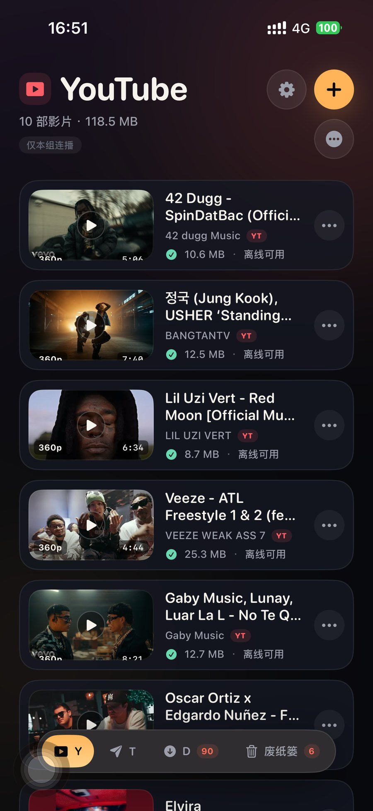
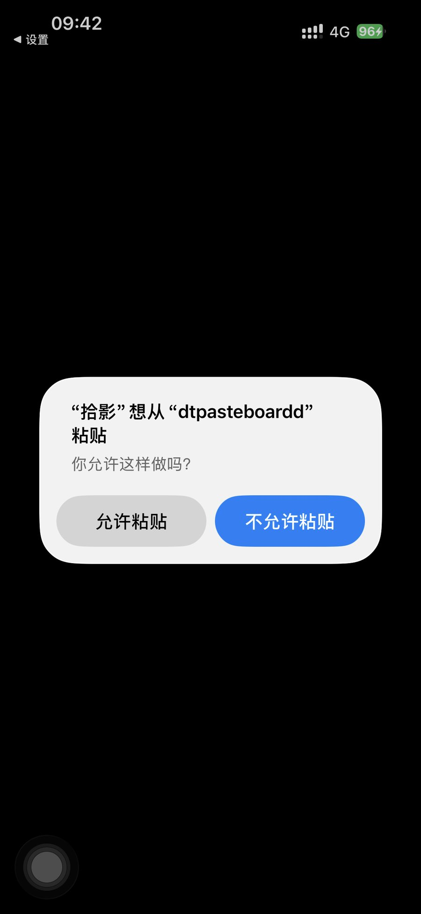
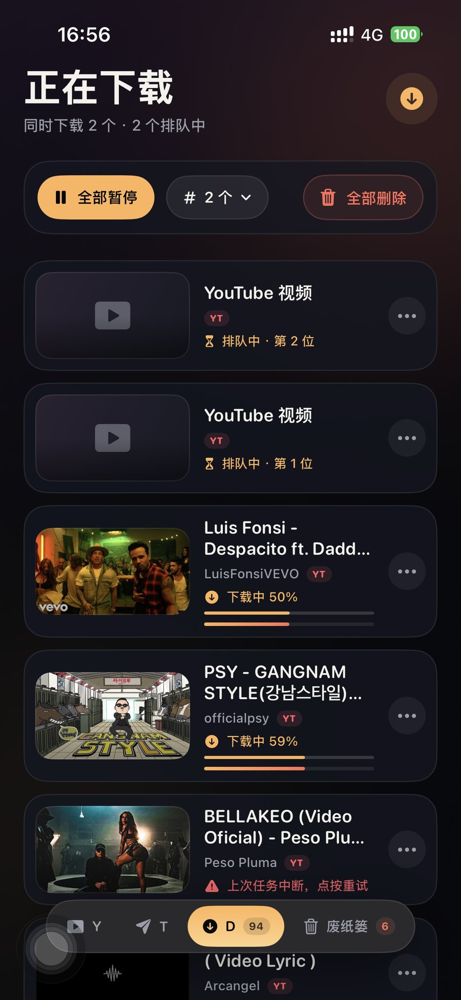
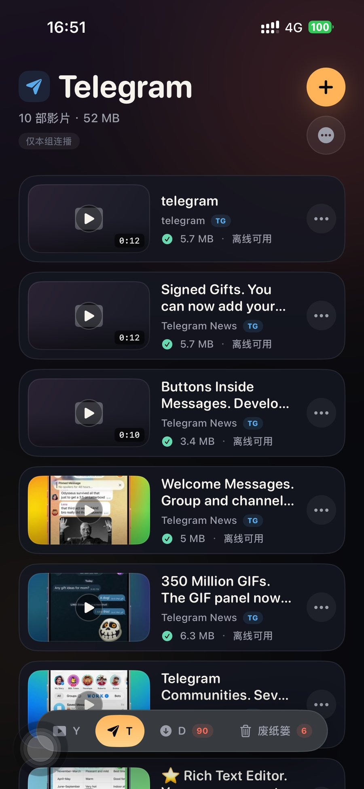
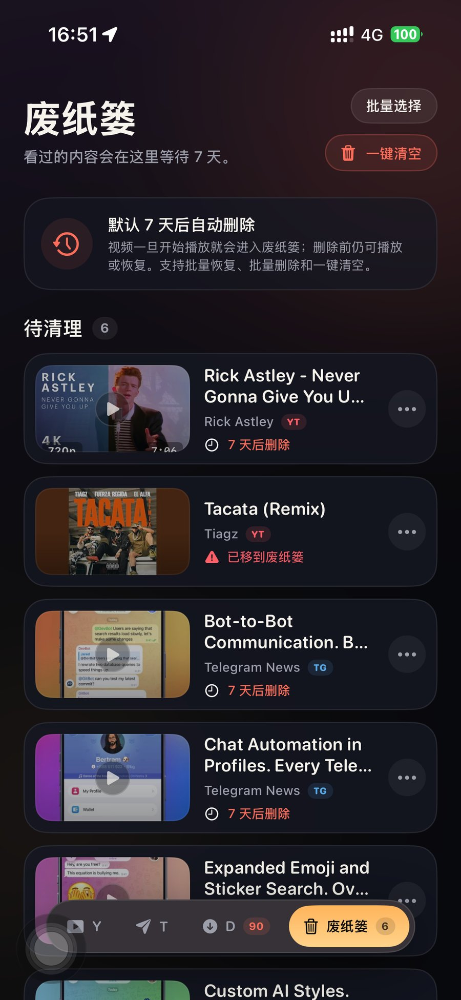

# 拾影使用教程

本教程按实际界面操作顺序说明：导入链接、下载、播放、清理和 Telegram 大视频登录。截图来自真机，深色界面在不同机型上布局会略有差异。

## 1. 界面总览

底部有四个入口：

| 入口 | 作用 |
| --- | --- |
| **Y**（YouTube） | 已下载的 YouTube 视频，按 YouTube 分组浏览与连播 |
| **T**（Telegram） | 已下载的 Telegram 视频，单独分组 |
| **D**（正在下载） | 下载队列、进度、暂停 / 继续、并发数 |
| **废纸篓** | 播放过或手动删除的视频，保留 7 天 |

四个入口互不干扰：下载中的任务统一在 D 查看，YouTube 与 Telegram 的片库和连播也各自独立。

## 2. 添加视频

### 方式一：分享面板（最顺手）

1. 在 YouTube App、Safari 或 Telegram 中点「分享」。
2. 在分享面板里选择「拾影」。如果没有看到，点「更多」把它打开。
3. 链接会自动解析并进入下载队列，不需要再手动粘贴。

### 方式二：在 App 内粘贴链接

1. 点右上角的 **+**。
2. 粘贴链接，支持：
   - YouTube 单条视频：`https://www.youtube.com/watch?v=...`
   - YouTube 播放列表：`https://www.youtube.com/playlist?list=...`
   - Telegram 公开帖子：`https://t.me/频道名/123`
   - Telegram 公开频道：`https://t.me/频道名`
3. 按需选择「下载画质」，默认是「最高可用（最高 1080p）」。
4. 点「开始下载」。播放列表会一次性加入队列，并自动去重。

### 方式三：剪贴板自动识别

开启「设置 → 剪贴板 → 自动读取剪贴板」后，打开 App 或从后台回到前台时，如果剪贴板里有受支持的链接，会直接导入。iOS 首次会询问是否允许粘贴：

- 选择「允许粘贴」即可自动导入。
- 不想自动读取时，可关闭开关；仍可在添加页点「粘贴剪贴板」手动导入。

> 已导入过的链接会跳过，不会重复下载。

## 3. 下载队列

所有任务都进入 **D** 页面，按加入顺序排队，同时下载数量默认为 2，可在页面顶部切换（1–4 个）。

- **全部暂停 / 全部开始**：暂停后按钮会变为「全部开始」，恢复所有任务；单个任务可以在「…」菜单里删除或取消自动重试。
- **失败重试**：网络波动会先自动重试 5 次；仍失败时点按该条目即可手动重试。
- **全部删除**：取消正在下载和排队中的任务，已下载完成的视频不受影响。
- 切换并发数只影响之后开始的任务，不会中断正在下载的任务。
- YouTube 下载使用系统后台传输，切到后台通常可以继续；Telegram 大文件由 TDLib 传输，切到后台可能暂停，回到 App 后会继续。
- 强退 App 后重新打开，未完成的任务会尽量自动恢复；无法恢复的任务会提示重新导入。

## 4. 播放

- 在 Y / T 或废纸篓里点视频即可进入全屏播放。
- 支持拖拽进度、快退 / 快进 10 秒，以及画中画（系统允许时）。
- 连播只在当前分组内进行：YouTube 队列播完不会接着播 Telegram，反之亦然。也可以在分组菜单里选择「仅本组连播」。
- 视频**开始播放后**会自动进入废纸篓（文件仍在本地），7 天后才真正删除，期间可随时恢复。

## 5. Telegram 视频

Telegram 公开频道和公开帖子都可以直接导入，下载完成后出现在 **T** 分组：

### 超过 20MB 的视频：扫码登录

Telegram 的公开网页预览只提供约 20MB 以内的文件。导入更大的视频时，App 会提示先登录，登录后改为通过 TDLib 直接下载原始文件。

1. 用 Telegram 手机号登录 [my.telegram.org](https://my.telegram.org)，进入 **API development tools**，创建一个应用，记下 `api_id` 和 `api_hash`（免费，只需一次）。
2. 打开 App：**设置 → Telegram 登录**，填写 API ID 和 API Hash，点「保存并扫码登录」。
3. 弹出二维码后，用已登录 Telegram 的手机扫描：
   - 手机在同一个 App 里：直接点「扫码登录」；
   - 手机不在身边：点「分享 / 发送到电脑」，把二维码图片发到电脑，再用手机扫描电脑屏幕；
   - 也可以「保存到相册」，从相册打开二维码用另一台设备扫描。
4. 二维码会自动刷新；在手机上确认后即完成登录。若账号开启了两步验证，按提示输入 Telegram 密码。
5. 登录后回到片库，重新导入刚才的大视频链接即可。

> 登录状态只保存在本机。API 凭证写入系统钥匙串；可在设置里随时「退出登录」。
>
> 若提示「需要验证码登录」或「账号未注册」，请先在 Telegram 官方 App 完成一次该账号的登录 / 注册，再回来扫码。拾影只支持扫码 + 两步验证密码，不处理短信验证码。

## 6. 废纸篓

- 视频开始播放或手动删除后进入废纸篓，默认保留 **7 天**，列表中会显示剩余天数。
- 支持单个恢复、批量选择、批量删除、一键清空。
- 「彻底删除」会立即从手机中删除文件，无法恢复。

## 7. 设置

- **下载画质**：最高可用（最高 1080p）/ 1080p / 720p / 480p / 360p。为保证原生播放和画中画，最高只下载 1080p；标题里的 4K 不代表实际分辨率。
- **并发下载**：1–4 个，超出数量的任务自动排队；也可在 D 页面随时调整。
- **来源分组**：YouTube 与 Telegram 分开浏览、分开连播。
- **Telegram 登录**：填写 API 凭证、扫码登录、查看登录状态或退出登录。
- **剪贴板**：自动读取开关与说明。

只影响之后加入的下载；已下载完成的视频不会被重新下载。

## 8. 常见问题

**导入 Telegram 链接提示“视频太大”？**
先完成上面的扫码登录，再重新导入一次。

**扫码后一直停在“等待扫码确认”？**
确认扫描的是最新二维码（会自动刷新）；确认手机上的 Telegram 已登录并且网络正常。可以关闭面板后重新打开。

**下载失败 / 进度停了？**
点按失败条目重试；检查网络与代理。Telegram 下载建议保持 App 在前台。

**为什么最高只有 1080p？**
YouTube 的 1440p / 4K 通常是 VP9 / AV1 编码，iPhone 原生播放和画中画不稳定，因此只选择 MP4 / H.264 流。

**卸载 App 会保留视频吗？**
不会。片库索引、缩略图、视频和 Telegram 登录态都保存在 App 沙盒内，卸载后一并清除。

**用免费 Apple ID 签名，多久要重装？**
免费签名通常 7 天过期，过期后需要重新构建安装；重新安装会清空 App 沙盒内的片库、视频与登录状态。
